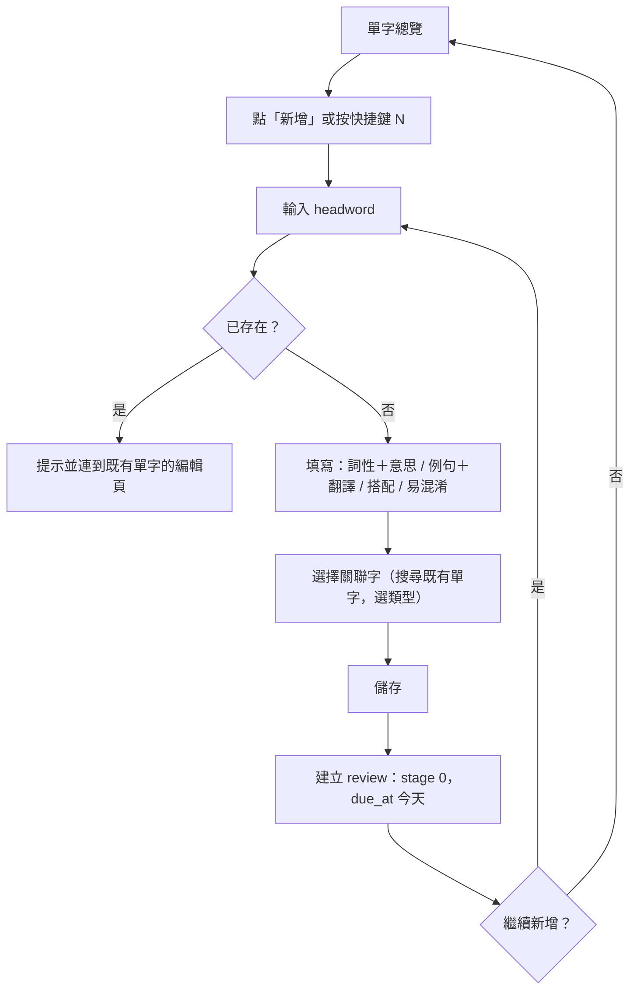
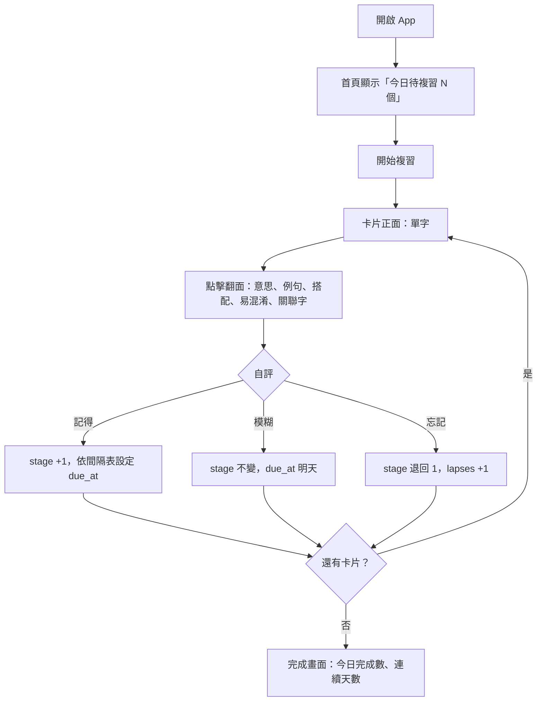

# 英文單字學習 Web App — Product Playbook

- 版本：v0.1（2026-11-06）
- 範圍：個人自用、Web（含手機瀏覽器）、多裝置同步
- 狀態：規劃中，尚未開發

---

## 1. 問題與機會

### 要解決的痛點

| 痛點 | 現況 | 影響 |
|---|---|---|
| 學到的單字散落各處 | 記在筆記本、Notion、手機備忘錄，格式不一 | 找不到、無法統一複習 |
| 現有工具的卡片結構太單薄 | Anki、Quizlet 預設只有「正面／背面」 | 「核心意思／例句／搭配／易混淆」需自己排版，輸入成本高 |
| 複習沒有固定節奏 | 想到才複習，或一次複習全部 | 依遺忘曲線，未在關鍵時間點複習的單字大多會在數天內遺忘 |
| 單字之間的關聯沒被記錄 | sway / swing 這類易混淆字分開記 | 無法在複習時一併比較，容易再次混淆 |

### 機會

- 使用者只有自己一人，需求明確，不需做市場驗證或商業化，可直接以「每天會不會打開來用」作為成敗標準。
- 單字內容格式已經固定（見第 4 節資料結構），可以做成結構化表單，比自由排版的卡片工具更快輸入、更好檢索。
- 免費等級的後端服務（BaaS）對個人用量已足夠，多裝置同步的成本約等於 0（估計，依據：Supabase 免費方案提供 500 MB 資料庫，單字資料每筆約 2–5 KB，可存數萬筆）。

### 為何是現在

- 已有固定的單字筆記格式與累積中的單字量，越晚建立工具，日後遷移的資料越多。
- PWA 與 BaaS 已成熟，一人可在數週內完成可用版本。

---

## 2. 目標使用者 persona

使用者只有一人，以下依「使用情境」拆成 3 個角色，用來確認每個情境都有對應功能。

### Persona A：輸入模式的我（電腦前）

- **背景**：閱讀文章、看影片或上課時遇到新單字，查完字典後想記下來。
- **目標**：在 1–2 分鐘內把一個單字的完整內容（意思、例句、搭配、易混淆）存進去。
- **痛點**：欄位多，手打費時；忘記某字是否已經存過。
- **使用情境**：桌機瀏覽器，鍵盤輸入，一次輸入 1–10 個字。
- **對應功能**：結構化輸入表單、重複字偵測、快捷鍵、關聯字建立。

### Persona B：複習模式的我（手機、零碎時間）

- **背景**：通勤、排隊或睡前有 5–10 分鐘空檔。
- **目標**：把今天到期的單字複習完。
- **痛點**：不知道今天該複習哪些字；手機上操作不便。
- **使用情境**：手機瀏覽器（加到主畫面的 PWA），單手操作，可能網路不穩。
- **對應功能**：今日複習清單、單字卡翻面、記得／模糊／忘記 三鍵評分、離線暫存後同步。

### Persona C：整理模式的我（週末回顧）

- **背景**：每週或每月想看自己累積了哪些字、哪些字一直記不住。
- **目標**：瀏覽、搜尋、修正內容，補上單字之間的關聯。
- **痛點**：單字量變多後難以找到特定字或某類字。
- **使用情境**：桌機或平板，瀏覽與編輯為主。
- **對應功能**：單字總覽（搜尋、篩選、排序）、難字清單、關聯圖、匯出備份。

---

## 3. 競品分析

價格為撰寫時已知的大約數字，以各官方網站為準。

| 產品 | 核心功能 | 價格（約） | 優點 | 缺點（對本需求而言） |
|---|---|---|---|---|
| **Anki** | 自訂卡片 + SM-2 間隔重複 | 桌機、Web、Android 免費；iOS 約 US$25 買斷 | 演算法成熟、可高度自訂、同步免費 | 自訂欄位與排版需學習成本；Web 版功能有限；無單字關聯 |
| **Quizlet** | 單字集、多種練習模式 | 免費 + Plus 約 US$36／年 | 介面簡單、輸入快 | 卡片只有兩面；間隔重複需付費；無易混淆／搭配欄位 |
| **Notion / 試算表** | 自建資料庫 | 免費起 | 欄位自由、可建關聯 | 沒有複習排程與單字卡模式，需手動安排 |
| **Memrise / Duolingo** | 內建課程 | 免費 + 訂閱 | 遊戲化、內容現成 | 無法輸入自己的單字，或輸入功能很弱 |
| **字典 App 生字本**（如 Cambridge、Longman） | 查字後一鍵收藏 | 免費 | 收藏快 | 只能存字典內容，不能加入自己的例句；無間隔複習 |

### 差異化切入點

1. **固定的四段式單字結構**：核心意思（依詞性）、語境例句、常見搭配、易混淆。表單直接對應這四段，不需自己排版。
2. **單字關聯是一級功能**：易混淆、同義、反義、同字根可以雙向連結。複習某字時，關聯字一起顯示。
3. **依遺忘曲線自動排程**：每天開啟就看到今日待複習清單，不需手動決定複習什麼。
4. **只做自己需要的**：不做社群、課程、遊戲化，介面維持簡單。

---

## 4. MVP 功能清單（含優先順序）

### 4.1 單字資料結構

以 `sway` 為例：

```text
Word
├─ headword: "sway"
├─ senses[]                      # 核心意思（依詞性分組）
│   ├─ { pos: "v.", meaning: "輕輕搖擺（物理）；左右、影響（抽象）" }
│   └─ { pos: "n.", meaning: "搖擺；支配力" }
├─ examples[]                    # 語境例句
│   ├─ { en: "The trees sway in the wind.", zh: "樹在風中搖曳。" }
│   ├─ { en: "Ads can sway voters.", zh: "廣告能左右選民。" }
│   └─ { en: "She holds sway over the team.", zh: "她在團隊中有支配力。" }
├─ collocations[]                # 常見搭配
│   └─ "sway in the wind", "sway public opinion", "hold sway", "be swayed by"
├─ confusables                   # 易混淆說明（文字）
│   └─ "sway 是輕微左右晃，swing 是較大的弧形擺盪（如鞦韆）。"
├─ links[]                       # 關聯字（雙向）
│   └─ { target: "swing", type: "confusable" }
├─ tags[]                        # 自訂標籤（來源、主題）
└─ review                        # 複習狀態
    ├─ stage: 0..7
    ├─ due_at: 2026-11-07
    ├─ last_reviewed_at
    └─ lapses: 0                 # 忘記次數，用來找出難字
```

### 4.2 複習排程規則（艾賓浩斯遺忘曲線）

採用固定間隔，依遺忘曲線的關鍵時間點設計：

| 階段 stage | 0 | 1 | 2 | 3 | 4 | 5 | 6 | 7 |
|---|---|---|---|---|---|---|---|---|
| 距下次複習 | 當天 | 1 天 | 2 天 | 4 天 | 7 天 | 15 天 | 30 天 | 已熟練（每 90 天抽查） |

評分規則：

- **記得**：stage + 1
- **模糊**：stage 不變，明天再出現
- **忘記**：stage 退回 1，`lapses` + 1

建議：先用固定間隔。累積 2–3 個月資料後，如果複習量過大或過小，再調整間隔或改用 SM-2／FSRS。

### 4.3 功能優先順序（MoSCoW）

#### Must（MVP 必須有）

| 功能 | 理由 |
|---|---|
| 帳號登入（Email magic link 或 Google） | 多裝置同步需要辨識使用者 |
| 雲端資料庫同步 | 電腦輸入、手機複習的核心需求 |
| 單字輸入表單（四段式欄位，可新增多筆詞性／例句／搭配） | 對應既有筆記格式，降低輸入成本 |
| 重複字偵測（輸入 headword 時即時提示已存在） | 避免同一字存兩次 |
| 單字總覽（列表 + 搜尋 + 依新增日期／到期日排序） | 需求明列；單字多了必須能找 |
| 單字詳細頁（顯示全部內容、可編輯、可刪除） | 修正內容的入口 |
| 關聯字連結（選擇既有單字建立雙向連結，類型：易混淆／同義／反義／同字根） | 需求明列；差異化核心 |
| 今日複習清單（`due_at <= 今天` 的單字） | 需求明列；每天自動跳出 |
| 單字卡學習（正面：單字；翻面：意思、例句、搭配、易混淆、關聯字；三鍵評分） | 需求明列 |
| 響應式介面（手機可單手操作） | 手機是主要複習裝置 |

#### Should（MVP 後第一批）

| 功能 | 理由 |
|---|---|
| PWA（加到主畫面、離線複習、恢復連線後同步） | 通勤時網路不穩 |
| 匯出／匯入 JSON、CSV | 資料備份，避免被單一服務綁住 |
| 標籤與篩選（如來源：文章／課程；主題） | 單字量超過數百筆後的整理需求 |
| 難字清單（`lapses` 高的單字） | 找出需要特別加強的字 |
| 每日複習提醒（Web Push 或 Email） | 依需求「每天都會跳出」，降低忘記開啟的機率 |
| 複習統計（每日完成數、連續天數、各 stage 分布） | 檢查是否持續使用、排程是否合理 |

#### Could（有餘力再做）

| 功能 | 理由 |
|---|---|
| AI 輔助填寫（輸入單字後自動產生意思、例句、搭配、易混淆草稿，人工確認後儲存） | 可大幅降低輸入時間，但需 API 費用與內容校對 |
| 發音（瀏覽器 Speech Synthesis） | 補足聽力記憶，實作成本低 |
| 關聯圖視覺化（以圖呈現單字網絡） | 整理模式有用，但不影響核心流程 |
| 反向卡片（看中文意思回想英文） | 提高主動回想難度 |
| 拼字測驗模式 | 加強拼寫 |

#### Won't（本階段不做）

| 功能 | 理由 |
|---|---|
| 原生 iOS／Android App | Web + PWA 已滿足需求，原生開發成本高 |
| 社群、分享、排行榜 | 個人自用，無需求 |
| 內建單字庫或課程 | 只用自己輸入的單字 |
| 付費、訂閱機制 | 不商業化 |

### 4.4 建議技術架構

| 層 | 建議 | 理由 |
|---|---|---|
| 前端 | React（Vite）或 Next.js + TypeScript | 生態系成熟，PWA 支援完整 |
| UI | Tailwind CSS | 快速做出響應式介面 |
| 後端／資料庫 | **Supabase**（Postgres + Auth + Row Level Security） | 免費方案足夠個人使用；關聯資料（單字 ↔ 關聯字）適合關聯式資料庫 |
| 部署 | Vercel 或 Cloudflare Pages | 免費、連結 GitHub 後自動部署 |
| 離線（Should） | IndexedDB 本地快取 + 連線後同步 | 手機離線複習 |

替代方案：Firebase（Firestore）也可行，但它是文件型資料庫，查詢關聯字的寫法比 Postgres 繁瑣，所以優先建議 Supabase。

資料表草案：

```sql
words        (id, user_id, headword, confusables, tags[], created_at, updated_at)
senses       (id, word_id, pos, meaning, sort_order)
examples     (id, word_id, en, zh, sort_order)
collocations (id, word_id, text, sort_order)
word_links   (id, user_id, word_a, word_b, type)   -- 雙向：查詢時 word_a 或 word_b 皆可
reviews      (word_id, stage, due_at, last_reviewed_at, lapses)
review_logs  (id, word_id, rating, reviewed_at)    -- 統計與日後調整演算法用
```

---

## 5. 核心使用者流程

### 5.1 首次使用

1. 開啟網站 → 用 Email magic link 或 Google 登入。
2. 進入空白的單字總覽 → 顯示「新增第一個單字」按鈕。
3. 手機開啟同一網址並登入 → 選擇「加到主畫面」（Should 階段）。

### 5.2 輸入單字（Persona A）



### 5.3 每日複習（Persona B）



### 5.4 整理（Persona C）

1. 單字總覽 → 搜尋或依標籤、到期日、難度篩選。
2. 點單字 → 詳細頁 → 編輯內容或補上關聯字。
3. 從關聯字直接跳到對方的詳細頁（例如 sway → swing）。

---

## 6. 成功指標（KPI）

個人工具的成敗標準是「持續使用」與「記得住」，不是用戶數。

| 指標 | 類型 | 目標值 | 量測方式 |
|---|---|---|---|
| **每週完成複習的天數** | 北極星 | ≥ 5 天／週 | `review_logs` 依日期去重計數 |
| 今日複習完成率 | 輔助 | ≥ 90% | 當日完成數 ÷ 當日到期數 |
| 複習正確率（記得 ÷ 總評分） | 輔助 | 70–90%（估計；低於 70% 代表間隔太長，高於 90% 可能太短） | `review_logs.rating` |
| 單字平均輸入時間 | 輔助 | ≤ 90 秒／字 | 開啟表單到儲存的時間差（前端記錄） |
| 每週新增單字數 | 輔助 | 依個人學習量設定，建議先觀察 2 週再定 | `words.created_at` |
| 已熟練（stage ≥ 6）單字占比 | 輔助 | 3 個月後 ≥ 30%（估計，依據：每字從新增到 stage 6 約需 30 天以上） | `reviews.stage` 分布 |

建議在 App 內做一個簡單的統計頁，直接顯示上述數字（Should 階段的「複習統計」）。

---

## 7. 上線時程與里程碑

假設：1 人開發，每週投入約 8–10 小時（估計）。時數不同時，依比例調整週數。

| 階段 | 週數（估計） | 產出 | 完成條件 |
|---|---|---|---|
| **0. 準備** | 0.5 週 | 建立 Supabase 專案、資料表、GitHub repo、部署流程 | 空白頁面可在正式網址開啟 |
| **1. 輸入與總覽** | 1.5 週 | 登入、單字輸入表單、重複字偵測、單字總覽、詳細頁 | 可輸入並瀏覽 20 個真實單字 |
| **2. 關聯字** | 1 週 | 雙向連結、類型選擇、詳細頁顯示並可跳轉 | sway ↔ swing 雙向可見 |
| **3. 複習排程與單字卡**（MVP 完成） | 1.5 週 | 排程規則、今日複習清單、單字卡翻面與三鍵評分、手機版排版 | 手機上可完成一輪今日複習，電腦上輸入的單字隔天出現在手機的待複習清單 |
| **4. 自用試行** | 2 週 | 每天實際使用，記錄問題 | 達到 KPI：每週 ≥ 5 天完成複習 |
| **5. Should 功能** | 2–3 週 | PWA 離線、匯出入、標籤、難字清單、提醒、統計 | 依試行期間的問題排序後逐項完成 |
| **6. Could 功能** | 視需要 | AI 輔助填寫、發音、關聯圖等 | — |

**MVP 可用時間：約 4.5 週**（階段 0–3）。

---

## 8. 風險與假設

### 關鍵假設

| 假設 | 驗證方式 | 不成立時的對策 |
|---|---|---|
| 四段式欄位每個字都會填 | 試行 2 週後，統計各欄位的填寫率 | 除 headword 與核心意思外，其他欄位改為選填；或優先做 AI 輔助填寫 |
| 每天會主動打開 App 複習 | 北極星指標（每週完成天數） | 提前實作每日提醒（Should → Must） |
| 固定間隔（1/2/4/7/15/30 天）適合自己 | 複習正確率是否落在 70–90% | 調整間隔，或改用 SM-2／FSRS |
| 手機瀏覽器足以應付複習 | 試行期間的操作體驗 | 加強 PWA；仍不足時再考慮原生 App |

### 主要風險

| 風險 | 可能性 | 影響 | 緩解措施 |
|---|---|---|---|
| 輸入太耗時，導致不再新增單字 | 中 | 高 | 快捷鍵、可動態新增的欄位、AI 輔助草稿（Could）；追蹤平均輸入時間 |
| 複習量累積過多，產生壓力而中斷 | 中 | 高 | 設定每日複習上限（例如 50 張），超出的順延；統計頁顯示未來 7 天的到期量 |
| 免費 BaaS 方案變更、暫停或專案被休眠 | 低–中 | 中 | Supabase 免費專案閒置一段時間會暫停，需定期使用或手動喚醒；Should 階段完成匯出功能並定期備份 |
| 離線複習後同步衝突（兩台裝置同時複習同一字） | 低 | 低 | 以 `last_reviewed_at` 較新者為準；複習紀錄存在 `review_logs`，不會遺失 |
| 開發時間不足，停在半成品 | 中 | 高 | 嚴格依 MoSCoW 執行，MVP 只做 Must；每個階段結束都是可用狀態 |
| 帳號安全（資料外洩） | 低 | 中 | 啟用 Supabase Row Level Security，每筆資料限 `user_id = auth.uid()` 存取 |

---

## 下一步

1. 確認本 playbook 的 MVP 範圍與技術選擇（Supabase + React）。
2. 建立 Supabase 專案與資料表（階段 0）。
3. 開始實作階段 1：登入、輸入表單、單字總覽。
